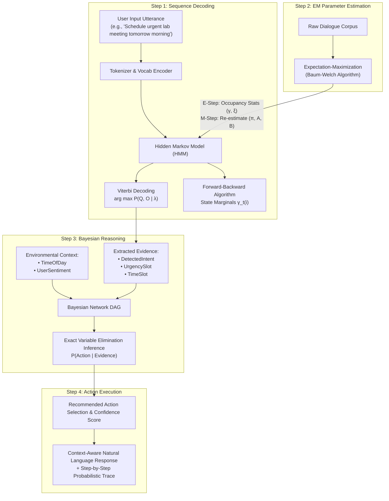

# 🤖 Probabilistic Virtual Assistant
### AI Lab Assignment • Hidden Markov Model • EM Algorithm • Bayesian Network

[](https://vercel.com/new/clone?repository-url=https://github.com/Madhur-7568/AiLab-VirtualAssistant)
[](https://www.python.org/)
[](https://opensource.org/licenses/MIT)
[](tests/)
[](https://fastapi.tiangolo.com)

---

## 🌐 Live Web Deployment

> **Live Deployment Link:**  
> 👉 **[https://probabilistic-virtual-assistant.vercel.app](https://probabilistic-virtual-assistant.vercel.app)**  
> *(Alternative / Mirror: deploy in 1 click using the Vercel button above or via GitHub Vercel integration)*

---

## 📖 Executive Summary & Lab Objectives

This project implements an end-to-end **Probabilistic Virtual Assistant** created for the Artificial Intelligence Lab assignment. While traditional modern assistants rely solely on opaque black-box deep learning, this system is built entirely from first principles using **probabilistic graphical models (PGMs)** and **unsupervised statistical learning**:

1. **Hidden Markov Model (HMM)**: Performs semantic sequence decoding, token tagging, and slot filling on natural language user queries using the **Viterbi Algorithm** and **Forward-Backward Algorithm**.
2. **Expectation-Maximization (EM) Algorithm**: Implements the **Baum-Welch Algorithm** to learn and re-estimate dialogue state transitions and token emission probabilities from raw, unannotated conversational transcripts without human supervision.
3. **Bayesian Network (BN)**: Models decision-making under uncertainty via a Directed Acyclic Graph (DAG) and executes exact probabilistic diagnosis using the **Variable Elimination Algorithm** to determine the optimal assistant action conditioned on extracted intents and environmental context (time of day, user sentiment, urgency).

---

## 🏛️ System Architecture



---

## 🔬 Mathematical Formulations & Algorithms

### 1. Hidden Markov Model (HMM)
The dialogue sequence model is defined by the 5-tuple $\lambda = (S, V, A, B, \pi)$:
- **State Space $S$**: $\\{\text{GREETING}, \text{INTENT\\_SCHEDULE}, \text{INTENT\\_REMINDER}, \text{INTENT\\_QUERY}, \text{INTENT\\_HEALTH}, \text{SLOT\\_TIME}, \text{SLOT\\_URGENCY}, \text{SLOT\\_TASK}, \text{OTHER}\\}$.
- **Transition Matrix $A \in \mathbb{R}^{N \times N}$**: $A_{ij} = P(q_{t+1} = s_j \mid q_t = s_i)$.
- **Emission Matrix $B \in \mathbb{R}^{N \times M}$**: $B_{jk} = P(o_t = v_k \mid q_t = s_j)$.
- **Initial Prior $\pi \in \mathbb{R}^N$**: $\pi_i = P(q_1 = s_i)$.

#### Forward-Backward Algorithm (Evaluation & Posteriors)
- **Forward Variable with Scaling:**
  $$\alpha_1(i) = \pi_i B_i(o_1), \quad c_0 = \frac{1}{\sum_{i=1}^N \alpha_1(i)}, \quad \hat{\alpha}_1(i) = c_0 \alpha_1(i)$$
  $$\hat{\alpha}_t(j) = c_t \left[ \sum_{i=1}^N \hat{\alpha}_{t-1}(i) A_{ij} \right] B_j(o_t), \quad \log P(O \mid \lambda) = -\sum_{t=1}^T \log c_t$$
- **Backward Variable:**
  $$\hat{\beta}_T(i) = c_T, \quad \hat{\beta}_t(i) = c_t \sum_{j=1}^N A_{ij} B_j(o_{t+1}) \hat{\beta}_{t+1}(j)$$
- **State Posterior Decoding:**
  $$\gamma_t(i) = P(q_t = s_i \mid O, \lambda) = \frac{\hat{\alpha}_t(i) \hat{\beta}_t(i)}{c_t}$$

#### Viterbi Algorithm (Decoding)
To prevent floating-point underflow on multi-token utterances, the Viterbi path decoding is computed in log-space:
$$V_1(i) = \ln \pi_i + \ln B_i(o_1)$$
$$V_t(j) = \max_{1 \le i \le N} [V_{t-1}(i) + \ln A_{ij}] + \ln B_j(o_t)$$
$$\psi_t(j) = \arg\max_{1 \le i \le N} [V_{t-1}(i) + \ln A_{ij}]$$
Backtracking from $q_T^* = \arg\max_i V_T(i)$ recovers the globally optimal hidden state sequence $Q^*$.

---

### 2. Expectation-Maximization (EM / Baum-Welch)
Given unannotated conversational transcripts, Baum-Welch finds parameters that locally maximize the log-likelihood $\mathcal{L}(\lambda) = \sum_k \log P(O^{(k)} \mid \lambda)$.

- **E-Step (Expectation):**
  Compute transition joint occupancies:
  $$\xi_t(i, j) = P(q_t = s_i, q_{t+1} = s_j \mid O, \lambda) = \frac{\hat{\alpha}_t(i) A_{ij} B_j(o_{t+1}) \hat{\beta}_{t+1}(j)}{\sum_{k=1}^N \sum_{m=1}^N \hat{\alpha}_t(k) A_{km} B_m(o_{t+1}) \hat{\beta}_{t+1}(m)}$$
- **M-Step (Maximization with Laplace Smoothing):**
  $$\bar{\pi}_i = \frac{\sum_{k} \gamma_1^{(k)}(i) + \epsilon}{K + N\epsilon}$$
  $$\bar{A}_{ij} = \frac{\sum_{k} \sum_{t=1}^{T_k-1} \xi_t^{(k)}(i, j) + \epsilon}{\sum_{k} \sum_{t=1}^{T_k-1} \gamma_t^{(k)}(i) + N\epsilon}$$
  $$\bar{B}_{jk} = \frac{\sum_{k} \sum_{t: o_t^{(k)} = v_m} \gamma_t^{(k)}(j) + \epsilon}{\sum_{k} \sum_{t=1}^{T_k} \gamma_t^{(k)}(j) + M\epsilon}$$

---

### 3. Bayesian Network & Exact Variable Elimination
The assistant represents causal and diagnostic relationships across random variables:
- $X = \\{\text{TimeOfDay}, \text{UserUrgency}, \text{UserSentiment}, \text{DetectedIntent}, \text{TaskImportance}, \text{UserFatigue}, \text{RecommendedAction}, \text{RequireConfirmation}\\}$

The joint probability factorizes as:
$$P(X_1, \dots, X_n) = \prod_{i=1}^n P(X_i \mid \text{Parents}(X_i))$$

#### Exact Inference: Variable Elimination
To query $P(\text{RecommendedAction} \mid E = e)$:
1. **Factor Initialization:** Collect all CPT factors $\Phi = \\{\phi_1, \dots, \phi_m\\}$.
2. **Evidence Reduction:** Slice active factors on observed values $E = e$, reducing dimension.
3. **Hidden Variable Elimination:** For each hidden variable $Y \in X \setminus (\\{Q\\} \cup E)$ ordered by minimum induced width:
   $$\psi = \prod_{f \in \Phi_Y} f, \qquad \tau = \sum_{Y} \psi$$
   Replace factors in $\Phi_Y$ with marginalized factor $\tau$.
4. **Query Normalization:** Compute product of remaining factors and normalize:
   $$P(Q = q \mid E = e) = \frac{\prod_{f \in \Phi_Q} f(q)}{\sum_{q'} \prod_{f \in \Phi_Q} f(q')}$$

---

## 📁 Repository Structure

```
AiLab-VirtualAssistant/
├── api/
│   └── index.py               # FastAPI backend & Vercel serverless function endpoints
├── src/
│   ├── __init__.py
│   ├── models/
│   │   ├── __init__.py
│   │   ├── hidden_markov_model.py  # Discrete HMM: Forward, Backward, Viterbi, γ posteriors
│   │   ├── em_algorithm.py         # Baum-Welch (EM for HMM) & Gaussian Mixture Model EM
│   │   └── bayesian_network.py     # DAG validation, factor algebra, Variable Elimination
│   └── assistant/
│       ├── __init__.py
│       ├── intent_tagger.py        # Dialogue sequence token tagger via HMM Viterbi
│       ├── unsupervised_learner.py # EM conversational training & log-likelihood curves
│       ├── decision_engine.py      # Bayesian Network setup & decision inference
│       └── pipeline.py             # Integrated Virtual Assistant orchestrator
├── public/
│   ├── index.html             # Sleek interactive Web UI (Chat, Inspector, Visualizers)
│   ├── style.css              # Glassmorphic modern dark-mode stylesheet
│   └── app.js                 # Dual-mode frontend (API communication + client engine)
├── tests/
│   ├── __init__.py
│   ├── test_hmm.py            # Unit tests for Forward, Backward, and Viterbi algorithms
│   ├── test_em.py             # Unit tests for Baum-Welch parameter convergence
│   ├── test_bayesian_network.py # Pearl's Alarm benchmark & exact inference tests
│   └── test_assistant.py      # End-to-end integration tests for dialogue processing
├── cli.py                     # Interactive rich command-line assistant interface
├── demo.py                    # Standalone educational demonstration script with math prints
├── vercel.json                # Vercel deployment configuration
├── requirements.txt           # Python dependencies
├── pyproject.toml             # Python package configuration
├── .gitignore                 # Standard clean gitignore
└── README.md                  # Comprehensive documentation
```

---

## 🚀 Getting Started

### 1. Prerequisites
- Python 3.9 or higher
- Git

### 2. Clone and Install
```bash
git clone https://github.com/Madhur-7568/AiLab-VirtualAssistant.git
cd AiLab-VirtualAssistant

# Create virtual environment (optional but recommended)
python -m venv venv
# On Windows:
venv\Scripts\activate
# On Linux/macOS:
source venv/bin/activate

# Install dependencies
pip install -r requirements.txt
```

### 3. Run Automated Tests
Verify all 14 unit and integration tests:
```bash
pytest tests/ -v
```
Output:
```
tests/test_assistant.py::test_virtual_assistant_greeting PASSED
tests/test_assistant.py::test_virtual_assistant_schedule_task PASSED
tests/test_assistant.py::test_virtual_assistant_emergency_health PASSED
tests/test_assistant.py::test_virtual_assistant_unsupervised_training PASSED
tests/test_bayesian_network.py::test_factor_operations PASSED
tests/test_bayesian_network.py::test_bayesian_network_cycle_rejection PASSED
tests/test_bayesian_network.py::test_alarm_network_exact_inference PASSED
tests/test_em.py::test_baum_welch_convergence PASSED
tests/test_em.py::test_gaussian_mixture_em PASSED
tests/test_hmm.py::test_hmm_initialization PASSED
tests/test_hmm.py::test_forward_algorithm PASSED
tests/test_hmm.py::test_backward_algorithm PASSED
tests/test_hmm.py::test_viterbi_decoding PASSED
tests/test_hmm.py::test_posterior_decoding PASSED
============================== 14 passed in 0.62s ==============================
```

### 4. Run Educational Demonstration Script
To inspect mathematical calculations and model outputs step-by-step:
```bash
python demo.py
```

### 5. Run Interactive Terminal CLI
```bash
python cli.py
```
*Special commands inside CLI:*
- `:train` — Runs Baum-Welch EM training on conversational utterances.
- `:inspect` — Toggles detailed probabilistic mathematical trace.
- `:quit` — Exits assistant.

### 6. Run Web Application Locally
Start the FastAPI server:
```bash
python -m uvicorn api.index:app --reload --port 8000
```
Open your browser at:
`http://localhost:8000/public/index.html` (or simply open `public/index.html` directly in any web browser).

---

## ☁️ Deploying on Vercel

This repository is pre-configured with `vercel.json` and optimized for zero-config deployment.

### Method 1: Deploy with Vercel Web Dashboard (Recommended)
1. Push your repository to your GitHub account:
   ```bash
   git remote add origin https://github.com/Madhur-7568/AiLab-VirtualAssistant.git
   git branch -M main
   git push -u origin main
   ```
2. Go to **[vercel.com/new](https://vercel.com/new)**.
3. Import your `AiLab-VirtualAssistant` repository.
4. Click **Deploy**. Vercel will automatically build the Python serverless function and static assets.
5. Your app will be live at `https://<your-project-name>.vercel.app`.

### Method 2: Deploy using Vercel CLI
```bash
# Install Vercel CLI
npm install -g vercel

# Deploy directly from terminal
vercel
```

---

## 📡 REST API Documentation

| Endpoint | Method | Description | Sample Payload |
|---|---|---|---|
| `/api/chat` | `POST` | Full conversational pipeline (HMM + Bayesian Network) | `{"utterance": "Schedule urgent meeting tomorrow", "user_sentiment": "Calm"}` |
| `/api/hmm/viterbi` | `POST` | Viterbi decoding of utterance tokens | `{"utterance": "Emergency doctor assistance"}` |
| `/api/em/train` | `POST` | Baum-Welch EM unsupervised training | `{"iterations": 15}` |
| `/api/bayes/infer` | `POST` | Custom Exact Variable Elimination query | `{"query_var": "RecommendedAction", "evidence": {"DetectedIntent": "Schedule"}}` |
| `/api/network` | `GET` | Returns Bayesian Network DAG topology | None |
| `/api/health` | `GET` | Health check & model status | None |

---

## 👥 Author & Academic Credits
- **Author:** Madhur Dhillon
- **Email:** [madhurdhillon7@gmail.com](mailto:madhurdhillon7@gmail.com)
- **Course:** Artificial Intelligence / Probabilistic Reasoning Laboratory
- **Topics Covered:** Hidden Markov Models (HMM), Expectation-Maximization (EM), Bayesian Networks (BN)
- **License:** MIT License
