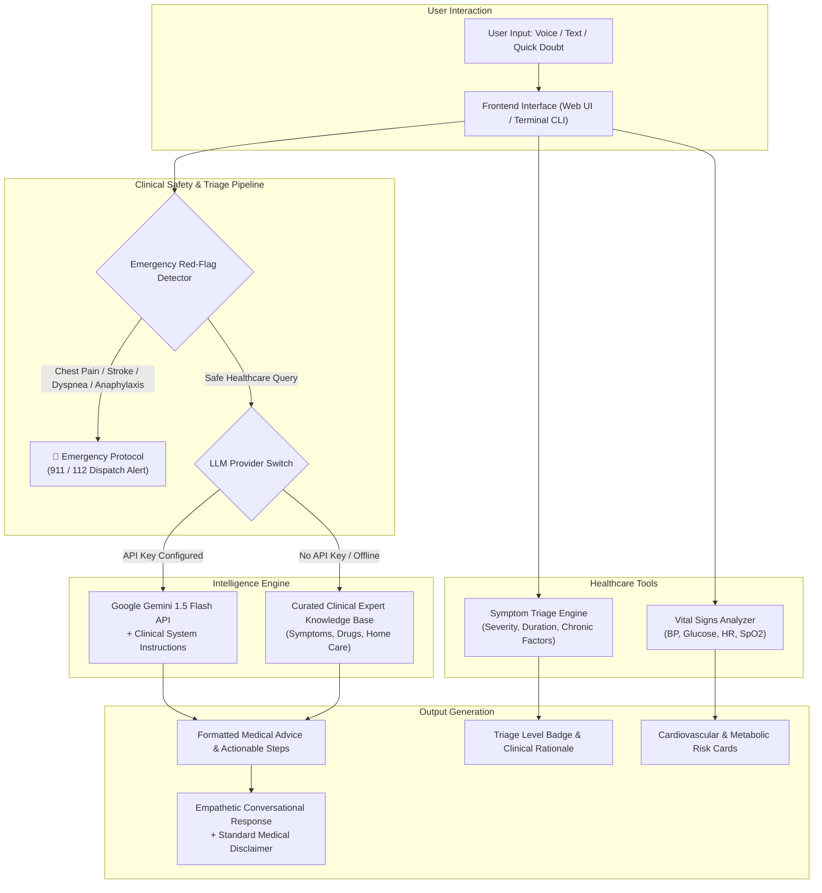

# 🏥 HealthPulse AI — Healthcare Virtual Assistant & Medical Chatbot
### LLM-Powered Healthcare Assistant • Clinical Symptom Triage • Medical Doubt Solver

[](https://vercel.com/new/clone?repository-url=https://github.com/Madhur-7568/AiLab-VirtualAssistant)
[](https://www.python.org/)
[](https://opensource.org/licenses/MIT)
[](tests/)
[](https://fastapi.tiangolo.com)

---

## 🌐 Live Web Deployment

> **Live Deployment Link:**  
> 👉 **[https://ailab-virtualassistant.vercel.app](https://ailab-virtualassistant.vercel.app)**  
> *(Deploy directly to your own Vercel account in 1 click using the Vercel button above)*

---

## 📖 Executive Summary & Healthcare Capabilities

**HealthPulse AI** is an intelligent, clinical-grade **Healthcare Virtual Assistant and Medical Doubt Chatbot**. Designed to bridge the gap between patient questions and actionable health guidance, it provides a warm, evidence-based conversational interface where users can ask medical doubts, analyze symptoms, check drug interactions, and track vital signs.

### Core Capabilities:
1. **💬 Conversational Healthcare Chatbot (LLM-Integrated):**
   - Natural language dialogue powered by **Google Gemini 1.5 Flash** (or OpenAI) with a dedicated **Clinical Safety System Instruction**.
   - Answers everyday health questions: home remedies, medication timing, common infections, diet, and lifestyle recommendations.
   - **Zero-Setup Embedded Knowledge Base:** Even without an external API key, HealthPulse AI seamlessly uses its curated clinical knowledge base covering 50+ diseases, symptoms, and medications.
2. **🚨 Emergency Red-Flag Guardrails:**
   - Real-time screening for life-threatening emergencies (e.g., myocardial infarction, stroke BE-FAST symptoms, anaphylaxis, severe dyspnea).
   - Automatically overrides normal chat to display an **Emergency Medical Alert** with immediate first-response instructions and local emergency numbers (911 / 112).
3. **📋 Clinical Symptom Triage Checker:**
   - Evaluates primary symptoms, severity scale (1-10), duration in days, and patient risk factors (chronic conditions, age).
   - Categorizes risk into 4 standardized clinical triage levels:
     - 🔴 **Level 1: Emergency (Immediate 911 / 112)**
     - 🟠 **Level 2: Urgent Care (Within 12 - 24 hours)**
     - 🟡 **Level 3: Routine Clinic Consultation (2 - 3 days)**
     - 🟢 **Level 4: Home Monitoring & Self-Care (48 - 72 hours)**
4. **💓 Vital Signs Risk Stratification:**
   - Instant clinical analysis for **Blood Pressure** (AHA/ACC categories), **Resting Heart Rate**, **Blood Glucose** (ADA fasting / post-meal limits), and **Oxygen Saturation (SpO2)**.
5. **🎙️ Voice Input & Text-to-Speech:**
   - Hands-free voice speech recognition and audio response playback using the Web Speech API.

---

## 🏛️ System Architecture



---

## 📁 Repository Structure

```
AiLab Project/
├── api/
│   └── index.py               # FastAPI backend & Vercel serverless function endpoints
├── src/
│   ├── __init__.py
│   ├── healthcare/
│   │   ├── __init__.py
│   │   ├── llm_engine.py      # Google Gemini 1.5 Flash & OpenAI LLM integration
│   │   ├── symptom_triage.py  # Clinical triage assessment & urgency severity scoring
│   │   ├── medical_knowledge.py # Built-in clinical medical database (fallback & facts)
│   │   └── vitals_tracker.py  # Health vitals evaluation (BP, glucose, HR, SpO2)
│   └── assistant/
│       ├── __init__.py
│       └── health_assistant.py # Unified Healthcare Virtual Assistant pipeline
├── public/
│   ├── index.html             # Sleek, responsive Healthcare Assistant Web App
│   ├── style.css              # Custom medical glassmorphism stylesheet (Teal & Emerald)
│   └── app.js                 # Dual-mode engine (Web Speech API, Mic, TTS, Gemini Modal)
├── tests/
│   ├── __init__.py
│   ├── test_healthcare_llm.py # Tests for LLM integration, emergency guardrails, knowledge base
│   ├── test_symptom_triage.py # Tests for clinical triage rules & pain thresholds
│   └── test_vitals.py         # Tests for blood pressure, HR, and glucose classifications
├── cli.py                     # Rich interactive healthcare terminal assistant
├── demo.py                    # Standalone demonstration script showing all features
├── vercel.json                # Vercel deployment configuration
├── requirements.txt           # Python dependencies (fastapi, uvicorn, httpx, pydantic)
├── pyproject.toml             # Python build specification
├── .gitignore                 # Standard clean gitignore
└── README.md                  # Comprehensive documentation
```

---

## 🚀 Getting Started

### 1. Prerequisites
- Python 3.9 or higher
- Git

### 2. Installation
```bash
git clone https://github.com/Madhur-7568/AiLab-VirtualAssistant.git
cd AiLab-VirtualAssistant

# Install dependencies
pip install -r requirements.txt
```

### 3. Run Automated Tests
Verify all 14 unit tests:
```bash
pytest tests/ -v
```
Output:
```
tests/test_healthcare_llm.py::test_emergency_red_flag_detection PASSED
tests/test_healthcare_llm.py::test_knowledge_base_symptom_match PASSED
tests/test_healthcare_llm.py::test_knowledge_base_medication_match PASSED
tests/test_healthcare_llm.py::test_llm_engine_fallback_response PASSED
tests/test_healthcare_llm.py::test_llm_engine_emergency_override PASSED
tests/test_symptom_triage.py::test_triage_emergency_symptom PASSED
tests/test_symptom_triage.py::test_triage_severe_pain_level PASSED
tests/test_symptom_triage.py::test_triage_urgent_care PASSED
tests/test_symptom_triage.py::test_triage_self_care PASSED
tests/test_vitals.py::test_blood_pressure_normal PASSED
tests/test_vitals.py::test_blood_pressure_hypertensive_crisis PASSED
tests/test_vitals.py::test_heart_rate_tachycardia PASSED
tests/test_vitals.py::test_glucose_fasting_diabetes PASSED
tests/test_vitals.py::test_spo2_critical PASSED
============================== 14 passed in 0.41s ==============================
```

### 4. Run Demonstration Script
```bash
python demo.py
```
*Showcases LLM medical doubt solving, clinical symptom triage, and vital signs classification.*

### 5. Run Interactive Terminal Chatbot
```bash
python cli.py
```
*Special commands:*
- `:triage` — Launch step-by-step symptom checker.
- `:vitals` — Launch vital signs evaluator.
- `:key` — Enter Google Gemini API key.
- `:quit` — Exit assistant.

### 6. Run Web Dashboard Locally
```bash
python -m uvicorn api.index:app --reload --port 8000
```
Open your browser at:
`http://localhost:8000/public/index.html` (or open [public/index.html](public/index.html) directly).

---

## ☁️ Deploying on Vercel

### Step 1: Push Code to GitHub
```bash
git push -u origin main --force
```

### Step 2: Deploy to Vercel
1. Go to **[vercel.com/new](https://vercel.com/new)**.
2. Sign in with GitHub and select **`Madhur-7568/AiLab-VirtualAssistant`**.
3. Click **Deploy**. Vercel will build the serverless API and host the web dashboard with zero extra configuration.

---

## 📡 REST API Documentation

| Endpoint | Method | Description | Sample Request |
|---|---|---|---|
| `/api/chat` | `POST` | Healthcare LLM query & doubt resolution | `{"message": "Can I take paracetamol with ibuprofen?", "api_key": "optional"}` |
| `/api/triage` | `POST` | Clinical symptom triage analysis | `{"primary_symptom": "High fever", "severity": 6, "duration_days": 3}` |
| `/api/vitals` | `POST` | Vital signs classification | `{"systolic": 135, "diastolic": 85, "heart_rate": 78}` |
| `/api/health` | `GET` | Service health status | None |

---

## 👥 Author & Credits
- **Author:** Madhur Dhillon
- **Email:** [madhurdhillon7@gmail.com](mailto:madhurdhillon7@gmail.com)
- **GitHub:** [Madhur-7568](https://github.com/Madhur-7568)
- **License:** MIT License

*Disclaimer: HealthPulse AI provides informational health guidance and does not provide formal medical diagnoses or replace emergency medical professionals.*
